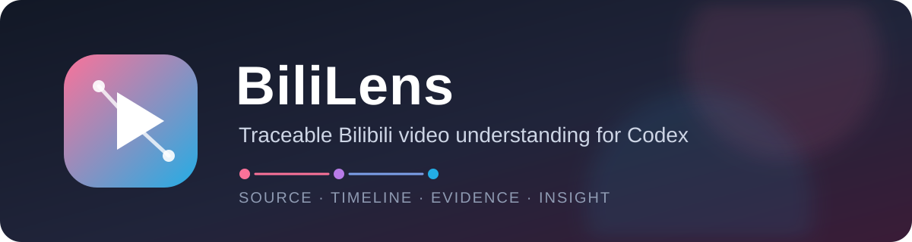

# BiliLens · Bilibili Video Parser for Codex

[简体中文](README.zh-CN.md) · [日本語](README.ja.md) · English



[](https://github.com/AntaresGG/BiliBiliVideoParser/actions/workflows/ci.yml)
[](https://github.com/AntaresGG/BiliBiliVideoParser/releases)
[](LICENSE)
[](https://github.com/AntaresGG/BiliBiliVideoParser/stargazers)

An evidence-aware **Bilibili video summarizer and transcript analyzer** packaged as an installable Codex Skill. Give Codex a Bilibili URL, `BV`/`av`/`ep`/`ss` identifier, and get a source-grounded Chinese summary, timestamped outline, clean transcript, claim-evidence map, or research report.

BiliLens understands Bilibili-specific details: multi-part videos, human and AI subtitles, optional local speech-to-text, live metadata, and danmaku reception signals. It keeps the speaker's claims, audience reactions, external facts, and Codex inferences visibly separate.

## Why BiliLens

- **Traceable by design** — important points stay linked to timestamps and source metadata.
- **Bilibili-native** — resolves short links, BV/av IDs, bangumi episode/season IDs, and `?p=` parts.
- **Subtitle-first** — prefers human subtitles, then AI subtitles, with local ASR only as a fallback.
- **More than a recap** — produces timelines, evidence chains, uncertainties, implications, and contradictions.
- **Audience-aware when requested** — samples danmaku, finds attention hotspots, and labels reception as reaction rather than proof.
- **Privacy-conscious** — anonymous extraction by default; authentication and local browser data are never accessed silently.
- **Flexible delivery** — returns results in chat or exports Markdown, TXT, JSON, SRT, and standalone HTML.

## Quick start

### 1. Install the plugin

Requires a current Codex CLI with plugin support.

```powershell
codex plugin marketplace add AntaresGG/BiliBiliVideoParser
codex plugin add bilibili-video-parser@bililens
```

If the skill does not appear immediately, restart Codex. Use `/skills` to confirm that `bilibili-video-parser` is available.

For standalone Skill installation, ask Codex:

```text
Use $skill-installer to install the skill from:
https://github.com/AntaresGG/BiliBiliVideoParser/tree/main/plugins/bilibili-video-parser/skills/bilibili-video-parser
```

### 2. Invoke it

Explicit invocation is the most predictable:

```text
Use $bilibili-video-parser to summarize this video with timestamps:
https://www.bilibili.com/video/BV...
```

Natural-language matching also works:

```text
分析这个 B 站视频，给我时间轴、核心论点和证据链：BV...
```

## Common use cases

| Goal | Example prompt |
|---|---|
| Fast summary | `Use $bilibili-video-parser to give me a concise summary of BV...` |
| Timestamped outline | `Create a timestamped outline for this Bilibili video: ...` |
| Clean transcript | `Extract and clean the transcript, preserving timestamps: ...` |
| Deep research | `Analyze the claims, evidence, uncertainties, and implications in BV...` |
| Multi-part selection | `Analyze part 3 of this Bilibili series: ...` |
| Danmaku reception | `Summarize this video and include danmaku hotspots and audience reactions: ...` |
| File export | `Export the analysis as Markdown and JSON to the current directory: ...` |

## What it can produce

BiliLens uses the sequence **Source Card → Timeline → Evidence Chain → Reception Field → Insight Layer**.

| Mode | Result |
|---|---|
| `metadata` | Canonical URL, selected part, uploader, publication time, live statistics, and source status |
| `transcript` | Timestamped source text with minimal correction |
| `cleaned_transcript` | Readable punctuation and paragraphs without semantic rewriting |
| `outline` | Source card and timestamped content structure |
| `summary` | Thesis, key points, representative evidence, and uncertainties |
| `research` | Claim-evidence mapping, contradictions, implications, and validation conditions |
| `full` | Transcript plus every applicable BiliLens layer |

Default output is returned in chat. Files are created only when requested.

## Content acquisition

1. Resolve the canonical video and selected part.
2. Fetch public metadata and available subtitle tracks anonymously.
3. Prefer human subtitles over AI subtitles.
4. Fall back to local ASR only when content analysis requires it and subtitles are unavailable.
5. Acquire danmaku only when audience analysis is requested.

Optional ASR may use [`bilibili-cli`](https://github.com/public-clis/bilibili-cli), `yt-dlp`, and `faster-whisper`. Model downloads and transcription happen locally. Names, numbers, tickers, jargon, accents, and overlapping speech can reduce ASR accuracy.

## Requirements

- Codex desktop app, CLI, or IDE extension with Skills support
- [`uv`](https://docs.astral.sh/uv/) and Python 3.12 for bundled scripts
- Internet access to public Bilibili endpoints
- Optional: `bilibili-cli`, `yt-dlp`, FFmpeg, and `faster-whisper` for ASR fallback

The default extractor uses only the Python standard library. This Skill does not require an OpenAI API key.

## Privacy and authentication

Anonymous extraction is the default. The Skill must ask before accessing browser cookies or environment credentials. If you deliberately enable authenticated extraction, credentials are sent to Bilibili as request cookies but are not written into generated output.

See [PRIVACY.md](PRIVACY.md) and [SECURITY.md](SECURITY.md). Never paste raw cookies or session tokens into chat, issues, or logs.

## Repository layout

```text
.
├── .agents/plugins/marketplace.json       # Codex marketplace catalog
├── plugins/bilibili-video-parser/
│   ├── .codex-plugin/plugin.json          # Installable plugin manifest
│   └── skills/bilibili-video-parser/
│       ├── SKILL.md                       # Skill trigger and workflow
│       ├── agents/openai.yaml             # Codex UI metadata
│       ├── references/                    # BiliLens and report guidance
│       └── scripts/                       # Extraction, ASR, and rendering tools
├── tests/                                 # Offline unit and structure tests
└── .github/                               # CI, release, and community templates
```

The installable Skill payload stays separate from repository documentation so Codex loads only task-relevant instructions.

## Development

```powershell
uv sync
uv run --python 3.12 python -m unittest discover -s tests -v
uv run --python 3.12 python -m compileall -q plugins/bilibili-video-parser/skills/bilibili-video-parser/scripts
```

Run the optional live endpoint check only when needed:

```powershell
uv run --python 3.12 plugins/bilibili-video-parser/skills/bilibili-video-parser/scripts/bilibili_extract.py --self-check
```

See [CONTRIBUTING.md](CONTRIBUTING.md) for contribution rules and [RELEASING.md](RELEASING.md) for the release process.

## Limitations and responsible use

- Subtitle availability depends on the video, account permissions, region, and Bilibili endpoint behavior.
- Danmaku represents audience reaction, not factual verification or a representative survey.
- The Skill does not bypass paywalls, access controls, DRM, or copyright restrictions.
- Users remain responsible for platform terms, copyright, privacy, and local law.
- This project is not affiliated with Bilibili or OpenAI.

## Release and license

Current release line: **v1.0.x**. See [CHANGELOG.md](CHANGELOG.md) and [GitHub Releases](https://github.com/AntaresGG/BiliBiliVideoParser/releases).

Released under the [MIT License](LICENSE). Copyright © 2026 AntaresGG.
